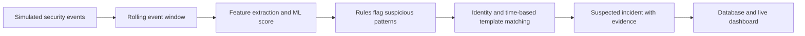

# Nexora: project explanation and viva preparation

Prepared against the current implementation and stored results on 2 November
2026. This guide explains the semester prototype; it does not claim production
security effectiveness. No source code or model is changed by this guide.

## 1. The definition to use consistently

**Project title:** Nexora — Security Event Correlation and Incident Reconstruction.

**One sentence:** Nexora analyses security events and connects related suspicious
activity into an explainable incident timeline for an analyst to review.

**Thirty-second explanation:**

> Our project is a security-event analysis and incident-reconstruction prototype.
> It processes events such as login attempts, API requests, database access and
> file downloads. Isolation Forest assigns anomaly scores, rules identify known
> suspicious patterns, and a correlation engine links relevant events using
> account, session, IP address and time. The dashboard presents the suspected
> incident, its entities and supporting evidence. Our current demonstration uses
> simulated events; real-log ingestion and automatic attack blocking are outside
> the implemented scope.

The **main problem** is fragmented evidence: separate events do not explain an
attack sequence on their own. The **main contribution** is an end-to-end,
inspectable pipeline for connecting that evidence. The intended user is a
security analyst or administrator reviewing a monitored application's activity.

## 2. Input, process, output and boundary

| Question | Answer |
| --- | --- |
| What is the input? | Structured security-event records. Runtime input currently comes from our simulator. |
| What happens to it? | Feature extraction, anomaly scoring, rule flagging and identity/time-based template matching. |
| What is the output? | Flagged events, reconstructed suspected incidents, evidence timelines, entity visualisations and recommended responses. |
| What environment does the demo represent? | An application with authentication, API, database, file-access and connection activity. |
| What is actually monitored on this laptop? | The generated event stream. The app does not inspect all laptop or Wi-Fi traffic. |
| Is it a firewall or antivirus? | No. It does not filter packets, scan executables or remove malware. |
| Is it a full SIEM? | No. It demonstrates a small SIEM-style event-analysis and correlation workflow. |
| Does it automatically prevent attacks? | No. It displays recommendations for human review. |

The broad category is security monitoring. The precise implemented task is
security-event correlation and incident reconstruction.

## 3. How the pipeline works

1. **Generate records:** the simulator emits normal events. An attack command
   inserts records representing one of the four supported attack scenarios.
2. **Standardise the format:** each record includes event type, time, user, IP,
   session and event-specific metadata. For example, an API event has an endpoint
   and status code; a file event can have a path, action and byte count.
3. **Calculate features:** event types, transfer/query sizes and recent activity
   counts become numeric inputs. Account-source diversity and distinct network
   destinations provide context. Generator severity and time-of-day were removed
   from ML features to reduce shortcuts.
4. **Score and flag:** Isolation Forest produces an unusualness score. Separate
   rules set the live flags and attack labels; a high ML score alone does not
   automatically become a live incident.
5. **Correlate:** templates check event order, shared identifiers and time limits.
   Only the necessary matching evidence becomes a reconstructed incident.
6. **Store and display:** SQLite persists events and incidents. REST endpoints
   provide snapshots; WebSocket messages push updates to the React interface.

The correlation engine is deterministic template matching, not a graph neural
network. It does not calculate Pearson correlation between numeric columns.

## 4. A running example

Suppose several IPs attempt to log into the account `admin`:

| Time | Source | Event |
| --- | --- | --- |
| 10:00:00 | IP A | Failed login to admin |
| 10:00:10 | IP B | Failed login to admin |
| 10:00:20 | IP C | Failed login to admin |
| 10:00:30 | IP A | Failed login to admin |
| 10:00:40 | IP D | Failed login to admin |

Five failures against the same account within 120 seconds meet the account-level
rule even though IPs and login sessions differ. The system can show an **Account
login attack** incident. It does not yet claim that the account was compromised.

If a successful login follows and its session performs database/file activity,
the richer compromise template can reconstruct that chain. Subsequent access
must match the successful session; the same account name alone does not justify
joining arbitrary database/file actions from other sessions.

This is a suspected pattern for review. A legitimate user can also repeatedly
fail authentication and later access data. Matching a template is not proof of
malicious intent or proof that the IPs belong to one person.

## 5. Networking questions

### Q1. Does changing IP address bypass your project?

It can bypass rules that count only per source IP. For login attacks, we now
aggregate failures by targeted account across IPs and sessions. An IP is one
linking attribute, not our only identity key. The same protection does not
automatically cover every distributed network attack.

### Q2. What if both IP addresses and accounts keep changing?

The current account-level rule can miss that campaign, particularly if each
account receives few attempts. We would need other reliable links: a trusted
device identifier, common targeted resource, authentication-client information,
or a separately validated campaign pattern. Without linking evidence, we cannot
reliably conclude that different events have the same attacker.

### Q3. What if an attacker tries only one password per account?

That resembles password spraying. A rule requiring five failures against one
account can miss it. A future detector should examine failures across many
accounts over time, with safeguards for legitimate activity. Do not claim this
campaign detector is already implemented.

### Q4. Is one IP address equal to one user or attacker?

No. NAT can put many users behind one public IP, and VPNs, proxies or address
changes can give one user multiple IPs. An IP identifies an observed network
source in the record; it does not establish a person's identity.

### Q5. What is NAT, and why does it affect detection?

Network Address Translation lets multiple private-network devices share public
addresses, commonly using ports to distinguish connections. A busy shared IP can
therefore exceed an IP-based API threshold even when individual users behave
normally. Production rules would need authenticated-user/API-key context and
workload-specific baselines. Nexora does not currently eliminate all NAT-related
false positives.

### Q6. Can you track the attacker's MAC address instead?

A MAC address is used on a local link. A remote web server normally does not
receive the original client's MAC address across routed networks. We cannot use
it as a universal identifier for internet clients. A managed endpoint agent
could provide a device identifier, but that is not implemented here.

### Q7. What if requests pass through a reverse proxy?

The application may see the proxy's source IP. A real ingestion integration must
recover client IPs only from a correctly configured trusted proxy or collector.
Blindly trusting a client-supplied forwarded-IP header would allow forged source
identity. The current simulation supplies its own IP fields; trusted-proxy
handling is future integration work.

### Q8. Does the project capture packets like Wireshark?

No. Its current input is event records, not captured packets. Connection events
represent network activity, but the app does not sniff a network interface,
perform packet reassembly or analyse arbitrary packet payloads.

### Q9. Does your project operate at a particular OSI layer?

Its main analysis is application-event analysis: authentication, API operations,
database activity and file access. Some records contain IP and port metadata
associated with network/transport activity. It is inaccurate to claim that the
prototype inspects all OSI layers or is an inline Layer-3 firewall.

### Q10. What is a port scan, and how do you recognise it?

A port scan probes services or hosts to discover reachable endpoints. Nexora's
rule looks for at least 15 distinct destination host/port pairs from one source
IP within 60 seconds. Repeated retries to the same host and port do not count as
15 distinct destinations. An open port alone does not prove a vulnerability.

### Q11. What if multiple IPs share the scanning work?

If each source stays below the threshold, the current per-IP scan rule can miss
it. The account-level login improvement does not fix distributed scanning.
Detecting it needs target-oriented/campaign-level aggregation and careful
false-positive evaluation. The current Isolation Forest does not reliably fill
this gap; its score-only scan recall on the final synthetic test was zero at
the selected operating point.

### Q12. What is the difference between TCP and UDP here?

TCP provides an ordered, reliable byte stream; UDP sends datagrams without those
delivery/order guarantees. Nexora currently analyses a general connection-event
record; it does not implement full TCP or UDP packet analysis. Browser/API and
WebSocket transport is separate from the simulated network events being analysed.

### Q13. Can you inspect HTTPS traffic?

The prototype does not decrypt HTTPS packets. An application can record events
after TLS termination, so trusted application logs can provide useful context
without a monitor decrypting arbitrary network traffic. Such log integration is
not currently implemented. Encryption does not make application logging
impossible, but it does limit what a passive network observer can see.

### Q14. What do firewall, IDS, IPS and SIEM mean?

| Term | Main role | Relation to Nexora |
| --- | --- | --- |
| Firewall | Enforces traffic access policies | Nexora does not enforce packet-filtering rules. |
| IDS | Detects suspicious activity and raises alerts | Nexora demonstrates detection using structured events. |
| IPS | Detects and blocks activity inline | Nexora does not implement inline blocking. |
| SIEM | Collects/manages security logs and correlates them for investigation | Nexora demonstrates a limited SIEM-style analysis/correlation pipeline, not a full platform. |

### Q15. What does localhost:8000 mean? Are you monitoring that port?

`127.0.0.1` is the local loopback address. Port 8000 hosts our web application,
REST API and WebSocket endpoint. It is not the set of ports we monitor: simulated
destination ports are metadata inside event records. A loopback-only server is
reachable from the same computer; it does not automatically monitor its LAN.

## 6. ML questions

### Q16. What is the ML model actually doing?

The live Isolation Forest learns patterns from benign training events and scores
incoming events for unusualness. Rules decide the live attack flags, and
templates reconstruct incidents. This is a hybrid pipeline; do not say the ML
model alone decides every attack.

### Q17. Why Isolation Forest?

It is an unsupervised anomaly-scoring algorithm. It uses random partitions;
observations that can be isolated with fewer partitions tend to be more unusual.
It provides a practical tabular baseline without requiring labelled examples of
every possible attack. An unusual observation is still not necessarily malicious.

### Q18. Why is Random Forest also present?

Random Forest is a supervised classifier trained using known attack labels.
The application-event classifier is evaluated offline as a comparison baseline.
It is not called by the live flagging pipeline. The uploaded network-flow
benchmark also evaluates separate Random Forest and Isolation Forest models.
These roles and feature spaces must not be mixed up.

### Q19. What features do you use?

Seventeen numeric features: one-hot event categories, logarithmic byte/row
volumes, error/download indicators, recent IP/user activity counts, failure-source
diversity and distinct connection destinations. The feature vector uses past
events available in the window, not an injected attack label as its input.
Generator severity and time-of-day were removed to reduce shortcuts.

### Q20. What are the model parameters?

The updated application Isolation Forest has 200 trees and 4,096 training
samples per tree. We compare candidate sample counts on validation data.
The display review threshold is 0.6, anchored to the selected raw threshold
of about 0.5860. It is not a 60% attack probability.

The offline application Random Forest has 200 trees, maximum depth 16, minimum
leaf size 3 and balanced class weights. Model names and parameters describe
their configuration, not proof of effectiveness.

### Q21. Is your anomaly detector fully unsupervised?

Its forest is fitted on benign events without attack-class labels. However,
operating-point selection uses labelled validation data to choose a threshold
under a false-positive budget. Therefore, model fitting is unsupervised, while
threshold selection is label-assisted. Do not claim that no attack labels are
used anywhere in evaluation/calibration.

### Q22. How did you separate training and testing?

The updated application evaluation generates whole windows independently:
training seed 42, validation seed 43 and final-test seed 45. The partitions have
25,218, 9,480 and 9,484 events respectively. Features are extracted within each
generated window. Seed 44 was used during development before the final test was
reserved. Separate synthetic seeds do not establish generalisation to real logs;
the same generator can repeat patterns across partitions.

### Q23. Why did precision improve while recall decrease?

We chose a validation operating point targeting at most 2% benign false
positives. A stricter operating point accepts fewer unusual events as positives.
That can reduce false alarms but miss more attacks. This is a measured trade-off,
not evidence that all model behaviour improved.

### Q24. What do the metrics mean?

| Metric | Meaning |
| --- | --- |
| Precision | Among predicted attacks/anomalies, what fraction were truly attacks in the labelled test? |
| Recall | Among actual labelled attacks, what fraction were detected? |
| F1 | Harmonic mean of precision and recall. |
| Benign false-positive rate | Among benign test events, what fraction were incorrectly marked positive? |
| Accuracy | Fraction of all correct predictions; can look high when one class dominates. |
| Macro-F1 | Average class F1 with equal weight per class; exposes weak smaller classes. |

The current application Isolation Forest's **score-only synthetic holdout** has
precision 94.82%, recall 60.73%, F1 74.04% and benign FPR 1.99%. These are not
measurements of the complete live rule-plus-correlation system.

### Q25. Why is there also a 99.3% figure in Analytics?

It belongs to the separate offline CICIDS network-flow Random Forest's binary
attack recall. The 60.73% figure belongs to application-event Isolation Forest
scoring on generated data. Different models, inputs and evaluation tasks produce
different results. Neither number means the full deployed app catches that
percentage of real attacks.

### Q26. Can it catch zero-day attacks?

Anomaly scoring may highlight unfamiliar behaviour, but we have not demonstrated
reliable zero-day detection. The incident templates recognise the implemented
known patterns. A high score for a novel event does not guarantee a reconstructed
incident or a correct malicious classification.

### Q27. Why retain rules when using ML?

Rules encode specific, explainable conditions and are useful where a general
anomaly model is weak. At the selected threshold, application IF scan recall is
0% and exfiltration recall about 30.4% on the synthetic test. The respective
rules provide complementary coverage in the demo. We must evaluate the complete
hybrid policy separately before making an overall effectiveness claim.

### Q28. What is the most important ML limitation?

The available records do not always distinguish benign and malicious intent.
A legitimate export and data theft may have the same account, query volume
and download size. More tuning cannot recover missing authorization/business
context. We need better input evidence and independently labelled real logs.

## 7. Correlation, graph and implementation questions

### Q29. What is an event, an alert and an incident?

An **event** is an observed action, such as a login failure. An **alert** is a
detection result indicating activity needs review. An **incident record** groups
matching evidence into a suspected security episode. A single login failure is
often ordinary; a burst of failures is suspicious; a failure burst followed by
data access provides a richer sequence to investigate.

### Q30. What exactly are the graph's nodes and links?

The frontend shows entities such as IPs, users, authentication activity,
endpoints, database tables, files and target hosts. Selecting one exposes its
related event evidence. The backend matches event sequences by identity, time
and template conditions. The displayed links convey incident relationships;
they do not prove every pair exchanged network packets or establish causation.

### Q31. What does incident reconstruction mean?

It means assembling a structured account of matching recorded activity:
which events occurred, when, which identities/resources appear, and which
supported pattern fits. It does not recover missing log records, prove human
identity, or recreate the attacker's screen.

### Q32. What are the four supported attacks?

| Type | Current detection/reconstruction scope |
| --- | --- |
| Brute force | Five failed logins per account within 120s, across IPs/sessions; later session-linked access can support a richer compromise pattern. |
| Port scan | At least 15 distinct host/port pairs per source IP within 60s. |
| API abuse | At least 25 API calls per source IP within 30s. |
| Data exfiltration | A download of at least 10 MB is flagged; the full template requires login, SELECT of at least 50,000 rows and bulk download within its time/session constraints. |

These are explicit demonstration thresholds, not universal definitions of attacks.
The project does not currently implement a general SQL-injection detector,
malware analysis or a complete catalogue of attack techniques.

### Q33. Why these time windows and thresholds?

They define a reproducible, bounded demonstration of bursts and sequences.
Real thresholds depend on normal workload, account type and resource sensitivity.
We would tune them against labelled representative traffic and measure false
alerts and missed attacks. There is no universal rule that 25 API calls must
be malicious.

### Q34. Is the graph a GNN or your original ML algorithm?

No. It is an evidence visualisation backed by deterministic sequence/template
matching. Isolation Forest and Random Forest are established algorithms. The
project's engineering contribution is integration, traceable evidence,
controlled evaluation and identity-aware incident reconstruction; do not claim
to have invented those algorithms or the concept of event correlation.

### Q35. What does an evidence score of 90/100 mean?

It is a heuristic based on a matched template and member-event signal strength.
It is not a calibrated 90% probability that an attack occurred and is not model
accuracy. Severity and evidence score also have different meanings: severity
prioritises risk; evidence score summarises the scoring formula's support.

### Q36. Is the system real-time if its events are simulated?

Yes in the limited sense that events are generated while the program runs,
processed continuously and pushed to the interface. Data origin and delivery
timing are different properties. Say **live processing of simulated events**,
not live monitoring of the college network. Normal demo events arrive roughly
every three seconds; injected scenarios are spread over about six seconds.
Processing and delivery add latency, so do not promise instantaneous detection.

### Q37. Does Inject Attack actually attack a computer?

No. It generates event records that represent an attack scenario. It does not
send real password guesses to an external server, scan the college network or
steal files. This makes functional tests controlled and repeatable, but it does
not substitute for an authorised real-system evaluation.

### Q38. Why use both simulated data and CICIDS2017?

Simulated application events let us test multi-step sequences with shared
accounts/sessions and known ground truth. Uploaded CICIDS network flows let us
evaluate separate flow-feature models on an external labelled dataset. CICIDS
is not automatically converted into the app's cross-service live event stream.
It is a complementary benchmark, not validation of every project component.

### Q39. Where is data stored, and why use WebSockets?

The current local deployment stores events/incidents in `D:\Nexora\Nexora\nexora.db`
using SQLite. Data survives restart. Raw CSVs and aggregate benchmark results
are separate files. PostgreSQL is supported in the deployment configuration.

REST provides request/response snapshots and simulation commands. WebSockets
maintain a connection so the server can push live event/incident/stat updates
without repeated polling. Neither transport is itself a detection algorithm.

### Q40. Is 4/4 scenario success the same as 100% accuracy?

No. It means four defined functional scenarios reconstructed correctly in a
self-check. It says little about other attacks, different users, benign
lookalikes or real environments. A detector's statistical accuracy requires
representative labelled samples, including negative examples.

### Q41. Is it production-ready or tamper-proof?

No production effectiveness or tamper-proof evidence claim is justified.
The local demo lacks real-log adapters, a built-in account system, mature
retention controls, complete operational monitoring and validated real-world
effectiveness. SQL storage and hashed incident identifiers do not make logs
cryptographically tamper-proof. Use one process for the current in-memory live
pipeline. Public use would need authentication, trusted ingestion, TLS and
appropriate data-handling controls.

### Q42. What improvements would you make next?

Connect a trusted application-log source; improve identity/authorization context;
evaluate on held-out real days/environments; add benign lookalikes, missing events
and distributed/slow campaigns; calibrate the full hybrid policy; then improve
operational security and scalability based on measured needs. Better evaluation
and evidence come before claiming a stronger model.

## 8. A five-minute demonstration

1. **Define scope first.** Use the thirty-second explanation. State that the
   stream is simulated and the goal is evidence correlation.
2. **Show an ordinary event.** Point to its type, time, user, IP, session and
   metadata. Explain why an event is not automatically an attack.
3. **Inject brute force.** Explain that this creates records, not real password
   attempts. Show the failure-only account incident if it is visible before
   the scenario completes, then inspect the fuller reconstructed evidence.
4. **Explain identity links.** Show the actual source/account/session values.
   The standard injected demo is not guaranteed to rotate IPs; do not claim
   it demonstrates rotation unless those IPs are actually present. The rotating-IP
   regression test is in `tests/test_distributed_detection.py`.
5. **Inspect the graph and evidence.** Click an entity and show its supporting
   events. Explain sequence matching, not causal proof or a learned GNN.
6. **Explain Analytics.** Keep the application-model synthetic test, external
   flow benchmark and four-scenario functional checks distinct.
7. **Finish with one limit and one next step.** For example: distributed scans
   can evade per-IP rules; target-oriented aggregation and real-log validation
   would be the next evaluated extension.

## 9. Claims to replace before the presentation

| Avoid saying | Say instead |
| --- | --- |
| We secure the entire network. | We demonstrate analysis and reconstruction of security-event records. |
| AI detects every attack. | ML scores unusual events; rules flag known patterns; templates assemble evidence. |
| We prevent attacks. | We support investigation and present recommended responses. |
| Our model is 99.3% accurate. | Name the model, dataset and metric; that figure is offline flow-classifier recall. |
| Four attacks passed, so accuracy is 100%. | Four defined functional scenario checks passed. |
| One IP means one attacker. | IP is an observed source attribute; account/session context can provide other links. |
| We trace every attacker even if identities change. | We can link events when the logs contain sufficient shared evidence. |
| The graph proves the attack path. | The graph visualises relationships in a suspected incident's recorded evidence. |
| The score is a probability. | It is an anomaly or heuristic evidence score, depending on the field. |
| CICIDS runs our live dashboard. | CICIDS supplies a separate offline network-flow benchmark. |
| The prototype is a complete enterprise SIEM. | It implements a limited SIEM-style event-analysis/correlation workflow. |

Memorise the project definition, the pipeline, the rotating-IP explanation and
the boundaries. Understand the other answers well enough to explain them in
your own words. If a capability is unimplemented, identify it as future work
rather than improvising an answer that contradicts the demonstration.

Documentation note: README.md currently contains unresolved merge-conflict
markers. Clean that file before submitting or sharing the repository; this
guide was grounded in implementation and stored results rather than its heading.
